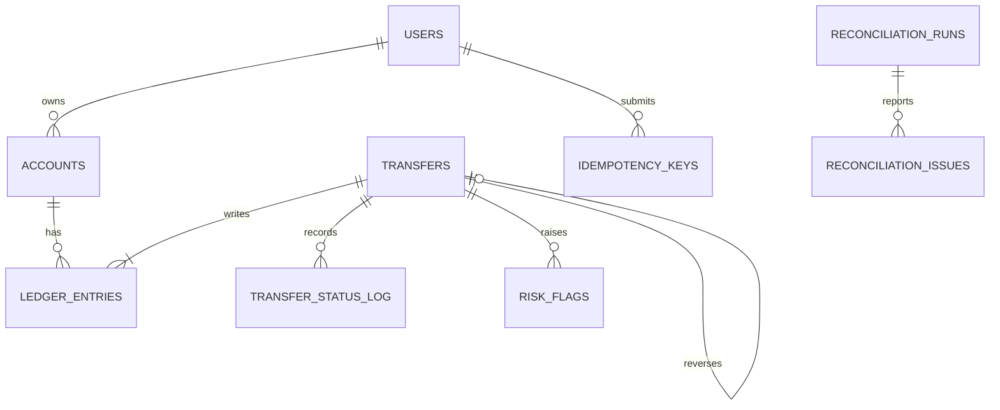

# Wallet ledger schema

## Nouns and tables

- `users`: identity, contact data, and KYC status.
- `accounts`: both user wallets and system accounts. A nullable `user_id` distinguishes system accounts.
- `transfers`: the business event and its lifecycle. Reversals point to the original transfer.
- `ledger_entries`: append-only debit and credit lines.
- `idempotency_keys`: one request body and response per user/key pair.
- `transfer_status_log`: immutable status history and actor.
- `reconciliation_runs` and `reconciliation_issues`: nightly consistency reports.
- `job_locks`: one row used to serialize reconciliation runs.
- `risk_rules` and `risk_flags`: database-configured fraud thresholds and decisions.

Emails and phone numbers are unique alternate attributes, not primary keys, because they are user-controlled and may change. System-generated `BIGINT` IDs remain stable foreign-key targets.

## Cardinality decisions

- One user has zero or many accounts; each user account belongs to one user.
- A system account belongs to no user.
- One account has zero or many ledger entries; every entry belongs to one account.
- One transfer has two or more ledger entries; every entry belongs to one transfer.
- One transfer can have zero or many status-log rows.
- One original transfer has zero or one reversal; a reversal points to one original.
- One user has many idempotency keys; `(user_id, key)` is unique.
- One reconciliation run has many issues.
- One transfer can have many risk flags, one per rule.

## Money and balances

Amounts are positive `BIGINT` paise values. Direction is stored separately as `debit` or `credit`. The API stores a balance on every account for fast reads, updates it in the same transaction as ledger entries, and the reconciliation job recomputes it from the immutable ledger.

User accounts have a database check preventing negative stored balances. The transfer path also locks all involved accounts in ascending ID order and rechecks the source balance while holding the locks.

## ER diagram

